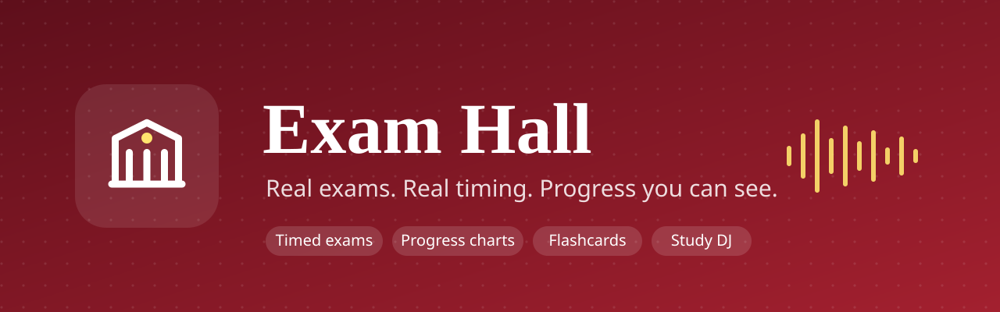

<p align="center">
  
</p>

<p align="center">
  <a href="https://zeffiroh.github.io/exam-hall/pass.html"></a>
  <a href="https://www.reddit.com/r/YOUR_SUBREDDIT"></a>
  <a href="https://discord.gg/YOUR_INVITE"></a>
</p>

<h3 align="center">Sit the exam before the exam.</h3>

<p align="center">
Full-length, timed practice papers that behave like the real thing, with instant marking, model answers,
progress charts that show which units are holding you back, and every mistake turned into a flashcard.
</p>

---

## What you get

| | |
|---|---|
| ⏱ **Real exam conditions** | Timed sections, locked sections, time warnings, full-screen proctoring, per-question timing. |
| ✅ **Instant marking** | Multiple choice, numeric and short answers marked on submit, with why each wrong option is wrong. |
| ✍️ **Proper answer tools** | LaTeX math, graphing, data tables, geometry construction, isometric grid and drawing pad for free response. |
| 📈 **Progress reports** | A written summary of how you're doing, score trends, results donuts, marks lost by unit, and a unit-by-attempt heatmap. Every exam has its own report. |
| 🃏 **Mistake flashcards** | Every missed question becomes a card with the answer and explanation. **Export to Anki** or **save as PDF**. |
| 🎧 **Study DJ** | Search free Creative Commons music and live study radio, with a live audio visualizer and class song requests. |
| 🏆 **Leaderboards** | See where you stand in your room, anonymised by default. |
| 🎬 **Movie night** | Watch a video together, in sync. |

## Exams in the library

| Exam | Format |
|---|---|
| 🧬 **AP Biology Midterm** | Units 0–4 · 40 multiple choice + 7 free response · 3 hours |
| ∑ **Mini INMO** | Olympiad proofs · 4 problems × 3 versions · 3 hours |

More exams are on the way. See the full list on the [access page](https://zeffiroh.github.io/exam-hall/pass.html).

## Get access

**Students join free.** Sign in with your name, email and the room code your teacher gives you. Your progress follows you to any device.

**Teachers:**
1. Open the **[access page](https://zeffiroh.github.io/exam-hall/pass.html)** and **pay what you want**: UPI, Indian or international cards.
2. Your teacher access code appears on screen right after checkout.
3. Sign in on the **Teacher** tab with that code. Create rooms, add any exam from the library, and give your students the room code.

Your rooms are yours: other teachers can't see or change them. Any teacher can **copy** a room if they know its room code. They get the activities and question sets, never your students or results.

## Community

Share scores, request new exams and swap study tips on **[Reddit](https://www.reddit.com/r/YOUR_SUBREDDIT)** and **[Discord](https://discord.gg/YOUR_INVITE)**.

---

<details>
<summary><b>Running your own Exam Hall</b></summary>

### One-time setup
1. In the Neon SQL editor, create the two roles:
   ```sql
   create role exam_student login password 'STUDENT-PASSWORD';
   create role exam_teacher login password 'TEACHER-PASSWORD';
   ```
2. Run `schema.sql` (run it again after every update).
3. Put the student connection string in `docs/js/config.js` (`studentConn`).
4. Put `TEACHER_PASSWORD=...` in `.env`. This is the site owner's login: type it on the Teacher tab to see every room, the library and settings.
5. Turn on GitHub Pages from `main` / `docs`.

### Add an exam
1. Paste the prompt from [`PROMPT.md`](PROMPT.md) into Claude and fill in the exam name.
2. Save the reply into `drop/`.
3. Run:
   ```bash
   python publish.py
   ```
   It files the set under `content/<exam>/`, checks every question, uploads only what changed to the **exam library**, and refreshes the catalog on the access page. Every teacher can add library exams to their rooms. New sets reach rooms that already have the exam.

| Command | Does |
|---|---|
| `python publish.py` | File new drops, check, upload changes |
| `python publish.py --check` | Check only |
| `python publish.py --offline` | File drops and rebuild the catalog without uploading |
| `python publish.py --room CODE` | Publish into one room instead of the library |

### Selling teacher codes (Razorpay, pay what you want)
1. In Razorpay, create a **Payment Page** with an amount field set to *Customer decides the amount* (with a small minimum), and turn on **international payments** in Settings if you want buyers outside India.
2. Set the page's after-payment redirect to `https://YOUR-SITE/unlock.html`.
3. Paste the page URL into `payLink` in `docs/js/config.js`.
4. Stock the code pool. Each code is one teacher login:
   ```bash
   python publish.py --mint 50      # add 50 teacher codes
   python publish.py --codes        # who claimed what, and how many rooms each teacher has
   python publish.py --revoke ABCD-EFGH-JKLM   # that teacher is signed out and their rooms close
   ```
After paying, the teacher lands on `unlock.html`, which releases one code for their payment ID (`pay_…`). If the redirect doesn't carry the ID, they paste it from their Razorpay receipt email. Entering the same ID again shows the same code. The site has no server, so it can't confirm a payment with Razorpay. Now and then, compare `--codes` with your Razorpay payments and revoke any code with no matching payment.

#### Emailing codes automatically
`.github/workflows/mail-codes.yml` runs `mail_codes.py` every 15 minutes. It reads captured payments from the Razorpay API, gives each buyer a code (the same code `unlock.html` shows for that payment ID), and emails it to the address on the payment. Each payment is emailed once.

1. In the repo, open **Settings → Secrets and variables → Actions** and add these secrets: `TEACHER_PASSWORD`, `RAZORPAY_KEY_ID`, `RAZORPAY_KEY_SECRET` (Razorpay → Account & Settings → API keys), `SMTP_HOST`, `SMTP_PORT` (465 or 587), `SMTP_USER`, `SMTP_PASS`, `MAIL_FROM`. For Gmail use `smtp.gmail.com`, port 465 and an app password.
2. Add a **variable** `SITE_URL`, for example `https://you.github.io/exam-hall`.
3. Run `schema.sql` again, then start the workflow once from the Actions tab to test it. `python mail_codes.py --dry-run` does the same locally with the values in `.env`.

GitHub can run scheduled workflows late when it is busy, so allow up to half an hour. Buyers can still get their code straight away on `unlock.html`.

### Community links
Set `community.reddit` and `community.discord` in `docs/js/config.js` to show them on the site, and replace `YOUR_SUBREDDIT`, `YOUR_INVITE` and `YOUR_SERVER_ID` above for the badges.

</details>

---

<p align="center">
  <br>
  Made by <a href="https://zeffiroh.github.io"><b>zeffiroh</b></a> · <a href="https://zeffiroh.github.io">zeffiroh.github.io</a>
</p>
